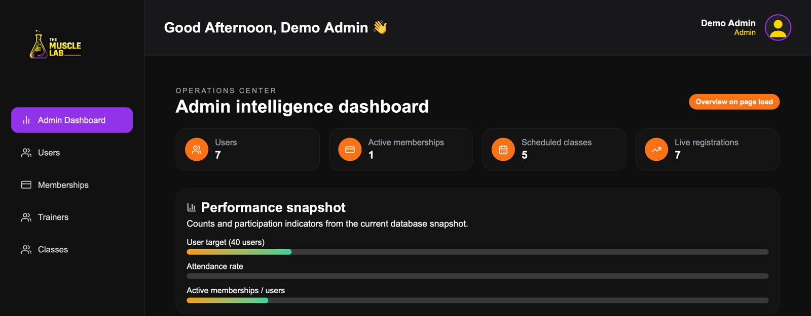
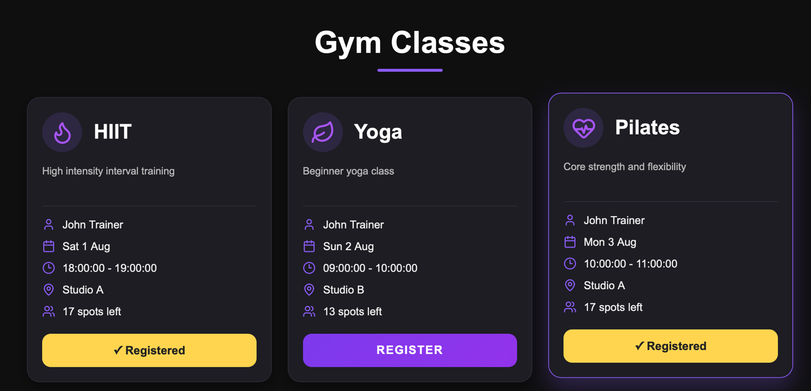
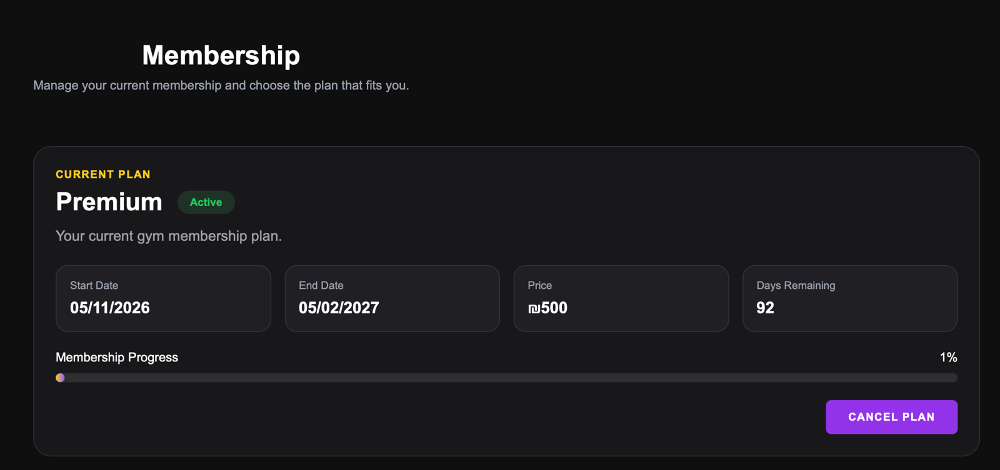
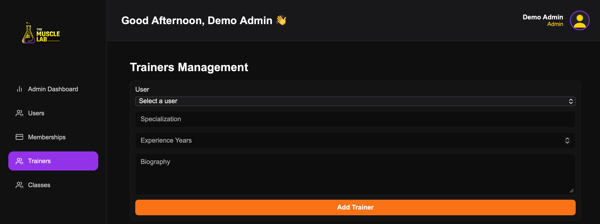
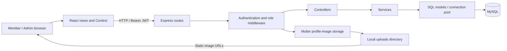
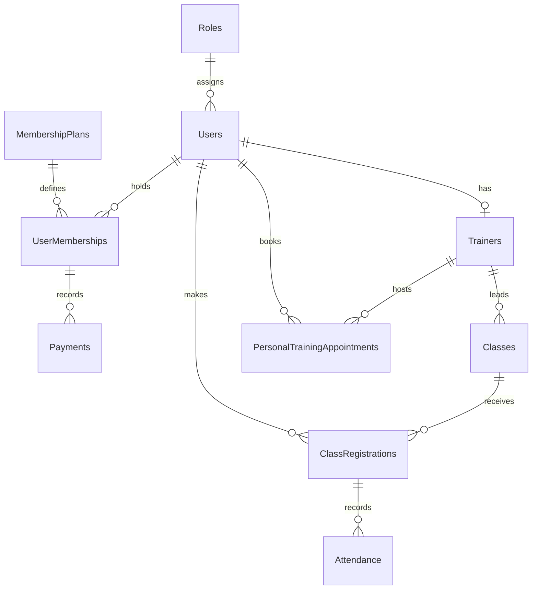

# The Muscle Lab

A full-stack gym management application for member self-service, class scheduling, and day-to-day administration.

**Members** manage their profiles, memberships, and class registrations. **Admins** manage trainers and classes and review gym activity. Built with **React, Express, and MySQL**, with JWT authentication and role-protected APIs.

**Engineering highlights:** transaction-safe class booking and membership enrollment · 10-table relational schema · JWT/RBAC · service, MySQL integration, and browser tests.

[Features](#features) · [Local setup](#local-setup) · [Architecture](#architecture) · [API](#api-overview) · [Testing](#testing) · [Screenshots](#screenshots)

## Features

| Role | Implemented workflows |
| --- | --- |
| Member | Register and sign in; edit profile and photo; change password; enroll in/cancel a membership; register for/cancel classes; view dashboard and monthly calendar. |
| Admin | View users and membership plans; create, edit, and delete trainer profiles and classes; review dashboard counts and recent activity. Additional APIs support user deletion, plan CRUD, and class participant lookup. |

The dashboard's **AI Coach** uses rule-based suggestions by default. An optional external `/coach` service can be configured; no language model or external AI backend is bundled.

## Screenshots

Real application screenshots, cropped for focus and privacy. Click an image to view it at full size.

**Admin dashboard** — User, membership, class, and registration counts with participation indicators.

[](docs/screenshots/admin-dashboard.png)

| Member class registration | Membership overview |
| --- | --- |
| [](docs/screenshots/member-class-registration.png) | [](docs/screenshots/member-membership.png) |
| Browse schedules and available places; see which classes are already registered. | Review the current plan, remaining days, and membership cancellation action. |

<details>
<summary>Explore the class calendar and Admin trainer form</summary>

**Class calendar** — A monthly grid with class counts for each scheduled day.

[](docs/screenshots/member-calendar.png)

**Trainer management** — Create a trainer profile by selecting a user and entering specialization, experience, and biography.

[](docs/screenshots/trainer-management.png)

</details>

## Tech stack

Versions are the ranges declared in the package manifests; `npm ci` installs the exact lockfile versions.

| Layer | Technologies |
| --- | --- |
| Frontend | React / React DOM `^19.2.7`, React Router DOM `^7.18.1`, Vite `^8.1.1`, React Context, custom CSS, Lucide and React Icons |
| Backend | Node.js, Express `^5.2.1`, mysql2 `^3.23.1`, dotenv `^17.4.2`, CORS `^2.8.6` |
| Database | MySQL; 10 relational tables with UUID identifiers and foreign keys |
| Authentication / uploads | jsonwebtoken `^9.0.3`, bcrypt `^6.0.0`, Multer `^2.2.0`, express-rate-limit `8.7.3`; Node's built-in UUID generator |
| Verification | Node test runner, Playwright, Oxlint |

## Architecture

React Router separates public, Member, and Admin views. React Context holds the shared user profile; fetch services communicate with the API. The backend uses routes, authentication/role middleware, controllers, services, and SQL models. Class services and the dashboard controller also query the connection pool directly.



```text
client/
├── src/components/     # Reusable UI, route guards, AI Coach
├── src/context/        # Shared user state
├── src/pages/          # Public, Member, Admin, and class views
├── src/routes/         # Client route definitions
├── src/services/       # API, authentication, and coaching helpers
├── test/               # Service regression tests
└── e2e/                # Browser workflow tests
server/
├── routes/             # Endpoint definitions and access requirements
├── middlewares/        # JWT verification, roles, uploads
├── controllers/        # HTTP handlers
├── services/           # Business rules and transactions
├── models/             # Parameterized SQL
├── config/             # MySQL connection pool
├── database/           # Schema and development seed
├── scripts/            # Safe database setup and local Admin creation
└── test/               # Security and opt-in HTTP integration tests
```

### Authentication and engineering decisions

- Passwords are bcrypt-hashed with 10 salt rounds. JWTs contain the user ID and role and expire after seven days.
- The client chooses localStorage or sessionStorage for login persistence. The API independently checks JWTs and Admin permissions; client route guards provide navigation restrictions.
- Class booking locks the class row inside a transaction before checking capacity. Membership enrollment locks the user row to prevent duplicate active enrollments under concurrent requests.
- Class cancellation changes registration status rather than deleting a row referenced by attendance records. Expired memberships are excluded from active-membership lookups.
- Authentication endpoints use per-IP throttling. Production requires an explicit `CORS_ORIGINS` allowlist; development defaults to loopback browser origins. Bearer headers are validated, and the Express signature header is disabled.
- Uploads use generated filenames, MIME-derived extensions, a 5 MiB limit, and JPEG/PNG/WebP MIME filtering. Files are public under `/uploads`; this is not content-signature validation.
- A single `VITE_API_URL` configures API requests and profile-image URLs. A local avatar fallback avoids sending user names to an external avatar service.

## Database design

[`schema.sql`](server/database/schema.sql) defines **10 tables**: `Roles`, `Users`, `Trainers`, `MembershipPlans`, `UserMemberships`, `Classes`, `ClassRegistrations`, `Attendance`, `PersonalTrainingAppointments`, and `Payments`.



A user can have one trainer profile; each user/class registration pair is unique. Attendance references are not unique in the schema. The seed includes Admin, Trainer, and Member roles, but the client has dedicated views only for Admin and Member. Payments and personal appointments are schema/seed entities, not implemented payment or booking workflows.

## API overview

All paths below start with `/api`. **Authenticated** means any valid JWT, not a Member-only role. Send `Authorization: Bearer <token>`.

| Method | Path | Access | Purpose |
| --- | --- | --- | --- |
| POST | `/auth/register`, `/auth/login` | Public | Create a Member account / sign in |
| GET | `/membership-plans`, `/membership-plans/:id` | Public | Browse plans |
| POST / PUT / DELETE | `/membership-plans`, `/membership-plans/:id` | Admin | Create / update / delete a plan |
| GET / PUT | `/users/profile` | Authenticated | Read / update own profile |
| PUT | `/users/profile/image`, `/users/change-password` | Authenticated | Upload multipart field `image` / change password |
| GET | `/users`, `/users/:id` | Admin | List / inspect users |
| DELETE | `/users/:id` | Admin | Delete an unreferenced user |
| GET | `/user-memberships/me` | Authenticated | Read own active membership |
| POST | `/user-memberships` | Authenticated | Enroll using `membership_plan_id` |
| PUT | `/user-memberships/cancel` | Authenticated | Cancel own membership |
| GET | `/classes`, `/classes/my` | Authenticated | Browse classes / own registrations |
| GET | `/classes/date-counts?start=YYYY-MM-DD&end=YYYY-MM-DD`, `/classes/by-date/:date` | Authenticated | Calendar counts / daily schedule |
| POST / DELETE | `/classes/:id/register` | Authenticated | Register / cancel registration |
| GET / POST | `/classes/admin` | Admin | List / create classes |
| PUT / DELETE | `/classes/admin/:id` | Admin | Update / delete a class |
| GET | `/classes/admin/:id/participants` | Admin | Inspect registrations |
| GET | `/trainers`, `/trainers/:id` | Authenticated | List / inspect trainers |
| POST / PUT / DELETE | `/trainers`, `/trainers/:id` | Admin | Create / update / delete a trainer profile |
| GET | `/dashboard/admin-overview` | Admin | Dashboard counts and recent activity |

For grouped CRUD rows, POST uses the collection path; PUT and DELETE use `/:id`.

## Local setup

### 1. Prerequisites and install

- Node.js **24.22.2** (pinned in `.node-version`), and npm. The manifests also permit `^20.19.0` or `>=22.12.0`.
- A running MySQL server supporting expression defaults. Local setup has been verified with Node **20.20.2** and MySQL **9.6.0**.
- A MySQL account with permission to create a new local database during setup.

```bash
git clone https://github.com/estisellam/The-Muscle-Lab.git
cd The-Muscle-Lab
npm ci --prefix server
npm ci --prefix client
```

Root dependencies are not required to run either application.

### 2. Configure

```bash
cp server/.env.example server/.env
cp client/.env.example client/.env
```

If these files already exist, edit them instead of overwriting them. Set your MySQL credentials, a new database name, and a random JWT secret. Generate a secret with:

```bash
node -e "console.log(require('node:crypto').randomBytes(32).toString('hex'))"
```

| File | Variables |
| --- | --- |
| `server/.env` | `DB_HOST`, `DB_PORT`, `DB_USER`, `DB_PASSWORD`, `DB_NAME`, `PORT`, `JWT_SECRET` |
| `server/.env` | `CORS_ORIGINS`: comma-separated exact frontend origins; required with `NODE_ENV=production`. Blank in development allows localhost/loopback ports. |
| `client/.env` | `VITE_API_URL`: backend origin, normally `http://localhost:3000`, **without** `/api` |
| `client/.env` | `VITE_AI_API_URL`: optional external coach origin; leave blank for local suggestions |

Environment files are ignored. Restart Vite after changing its variables. An external coach URL sends profile, membership, and class data to that service; no browser-side API key is required by the bundled application.

### 3. Initialize a new local database

```bash
npm run db:setup --prefix server
```

This creates `DB_NAME`, its 10 tables, and the development seed. It **refuses an existing database** and never drops one. If setup fails partway through, inspect that new database before choosing a different name and retrying.

The raw `server/database/schema.sql` starts with `DROP DATABASE`; do not run it against existing data. The safe setup command strips its database-selection/reset statements and uses the configured new database. Seed class dates are in August 2026; use the calendar's month controls or create future classes as an Admin.

### 4. Run both applications

In separate terminals, from the repository root:

```bash
npm run dev --prefix server
```

```bash
npm run dev --prefix client
```

The backend defaults to `http://localhost:3000`. Open the URL printed by Vite, normally `http://localhost:5173`. The backend creates its upload directory automatically. `npm start --prefix server` runs without nodemon.

The seed contains four **fictional, local-development-only accounts**, all with the public demo password `Local-demo-only-2026!`:

| Role | Demo email |
| --- | --- |
| Admin | `demo-admin@example.com` |
| Trainer | `demo-trainer@example.com` |
| Member | `demo-member-one@example.com` |
| Member | `demo-member-two@example.com` |

These are disposable fixtures, not deployment credentials. Never use these accounts or this password in an Internet-facing deployment. The Trainer role has no dedicated client workspace. The seed stores bcrypt verifiers and leaves phone numbers, birth dates, and gender unset. Updating `seed.sql` does not alter existing databases.

You can also register a Member through `/register`. To create a **new local Admin** with credentials of your own choosing:

```bash
DEV_ADMIN_EMAIL=admin@example.invalid DEV_ADMIN_PASSWORD='<choose-a-local-password>' npm run dev:admin --prefix server
```

Use a password of at least six characters and at most 72 UTF-8 bytes. This command refuses existing emails and does not reset any account. It is disabled when `NODE_ENV=production`.

### 5. Build

```bash
npm run build --prefix client
npm run preview --prefix client
```

The build is written to `client/dist`. Preview is for local inspection, not a production deployment.

## Testing

```bash
npm test --prefix server
npm test --prefix client
npm run lint --prefix client
```

The default server command runs security/hardening tests and skips the database suite. See [testing instructions](docs/TESTING.md) for the opt-in integration and browser suites, isolated database setup, and screenshot capture.

**Verified locally on 5 November 2026:** 29 backend tests, 7 client tests, and 4 browser scenarios passed with no failures. Clean-source dependency installs, new-database initialization, backend start/dev, frontend dev, and production builds passed using Node 20.20.2 and MySQL 9.6.0. Oxlint reports one Context/Fast Refresh warning and no errors.

## Current limitations

- Password reset is a form placeholder; it does not send email. Trainer accounts have no dedicated dashboard.
- User and membership-plan Admin screens are read-only; their additional operations are available through APIs. Trainer and class forms select users/trainers by name while preserving UUID-based API payloads.
- There is no payment processing, personal-training booking API, or attendance-management UI.
- Dashboard statistics load on page entry; there are no WebSocket updates or historical growth/renewal calculations.
- This is a verified local portfolio application, not a claim of production hardening. Image content validation, shared rate-limit storage, token revocation, and several deletion/validation rules remain open; see [security and deployment notes](docs/SECURITY.md).

## Author

[Esther Hadas Vaknin](https://github.com/estisellam)
